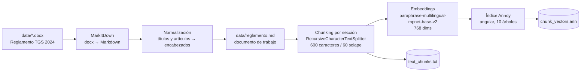
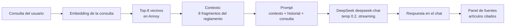

# Asistente del Reglamento de Evaluación — Colegio Talagante Garden School

Servicio conversacional (RAG) que responde consultas sobre el **Reglamento Interno de
Evaluación y Promoción Escolar 2024** del Colegio Talagante Garden School, combinando
búsqueda semántica sobre el documento con un modelo de lenguaje como generador de
respuestas.

Construido con **Chainlit**, **MarkItDown**, **SentenceTransformers** y **Annoy**, con
**DeepSeek** como modelo de lenguaje.

---

## Tabla de contenidos

- [Cómo funciona](#cómo-funciona)
- [Estructura del proyecto](#estructura-del-proyecto)
- [El documento fuente](#el-documento-fuente)
- [Requisitos](#requisitos)
- [Instalación](#instalación)
- [Configuración](#configuración)
- [Uso](#uso)
- [Pruebas](#pruebas)
- [Regenerar el índice](#regenerar-el-índice)
- [Parámetros del sistema](#parámetros-del-sistema)
- [Limitaciones conocidas](#limitaciones-conocidas)
- [Roadmap](#roadmap)
- [Licencia](#licencia)

---

## Cómo funciona

El servicio implementa un pipeline **RAG (Retrieval-Augmented Generation)** en dos fases.

**1. Ingesta (offline)** — `scripts/convert_docx_to_markdown.py` → `preprocessing_text_and_embeddings.py`



MarkItDown convierte el Word original a Markdown conservando listas y tablas. Un
post-proceso promueve los rótulos **TÍTULO**, **ARTÍCULO** y **N°** a encabezados, de
modo que el chunking respete la estructura normativa. Ese `.md` es la **fuente de
verdad** del proyecto: es lo que se versiona, se revisa y se indexa.

**2. Consulta (online)** — `app.py` + `rag.py`



La respuesta se transmite en streaming y cada mensaje adjunta los fragmentos usados
como contexto, para que el usuario pueda contrastarla contra el reglamento. El
historial de la conversación se envía al modelo (últimos seis mensajes).

---

## Estructura del proyecto

```
chatbot_reg_ev/
├── data/
│   ├── REGLAMENTO INTERNO DE EVALUACION Y PROMOCIÓN ESCOLAR TGS 2024 ... .docx
│   └── reglamento.md                     # Markdown generado (documento de trabajo)
├── scripts/
│   ├── convert_docx_to_markdown.py       # docx → Markdown + normalización de encabezados
│   └── smoke_test.py                     # verificación de artefactos, recuperación y generación
├── .chainlit/config.toml                 # Configuración de la interfaz
├── app.py                                # Interfaz de chat (Chainlit)
├── config.py                             # Parámetros y prompt del sistema
├── rag.py                                # Recuperación, prompt y generación con streaming
├── chainlit.md                           # Pantalla de bienvenida
├── preprocessing_text_and_embeddings.py  # Ingesta: Markdown → chunks → índice Annoy
├── text_chunks.txt                       # Fragmentos indexados (artefacto generado)
├── chunk_vectors.ann                     # Índice vectorial Annoy (artefacto generado)
├── requirements.txt
├── LICENSE                               # GPL-3.0
└── README.md
```

| Archivo | Responsabilidad |
|---|---|
| `app.py` | Interfaz de chat. Recibe el mensaje, muestra el paso de recuperación y transmite la respuesta con sus fuentes. |
| `rag.py` | Núcleo independiente de la UI: `retrieve()`, `build_prompt()`, `stream_answer()` y `answer()`. Cachea modelo, índice y fragmentos. |
| `config.py` | Rutas, modelos, `top_k`, temperatura y *system prompt*. |
| `data/reglamento.md` | Salida de MarkItDown ya normalizada. Entrada del pipeline. |
| `scripts/convert_docx_to_markdown.py` | Convierte el Word a Markdown y reconstruye la jerarquía de títulos y artículos. |
| `preprocessing_text_and_embeddings.py` | Script de un solo uso: divide el Markdown por sección, calcula embeddings y persiste los artefactos. |
| `scripts/smoke_test.py` | Verificación de extremo a extremo: artefactos, alineación del índice, recuperación y generación. |

---

## El documento fuente

| Campo | Detalle |
|---|---|
| Nombre | Reglamento Interno de Evaluación y Promoción Escolar TGS 2024 |
| Establecimiento | Colegio Talagante Garden School (Fundación Garden School) |
| Versión | Revisión 2024, con portada |
| Formato original | `.docx` (Word 2007+), 1,1 MB |
| Extensión | 1.281 párrafos, 3 tablas, 11 imágenes |
| Estructura | Títulos I–VI, Artículos 1°–45° |
| Marco normativo citado | Decreto 67/2018, Resolución Exenta N°1.856/2016, Ley 20.370, Ley 20.845, Decreto 83/2015, Decreto 170/2009, SIGE |

El documento cubre, entre otras materias: evaluación diagnóstica, formativa y sumativa;
criterios de promoción; niveles de exigencia (PREMA 60%); escalas de calificación;
exámenes especiales; talleres JECD; calificaciones y apelaciones; y las medidas de
acompañamiento pedagógico (PROAT).

**Conversión a Markdown:**

```bash
python scripts/convert_docx_to_markdown.py
```

> El `.docx` no usa estilos de título de Word, por lo que MarkItDown devuelve párrafos en
> negrita en lugar de encabezados. El script detecta los rótulos `TÍTULO`, `ARTÍCULO` y
> `N°` y los convierte en `##`/`###`/`####`; además une el rótulo con el nombre del
> título o artículo que Word deja en la línea siguiente.
>
> El nombre del archivo original está en Unicode NFD (la tilde de "PROMOCIÓN" es un
> carácter combinado), por lo que el script lo localiza con `glob("data/*.docx")` en vez
> de con una ruta escrita a mano.

---

## Requisitos

- **Python 3.12** (evita problemas de wheels con `torch` en versiones muy nuevas)
- **`uv`** o `venv` + `pip` para el entorno
- ~2 GB de disco (el modelo de embeddings se descarga la primera vez, ~1 GB)
- **API key de DeepSeek** (variable de entorno `DEEPSEEK_API_KEY`)

---

## Instalación

```bash
git clone https://github.com/gonzakayunawel/chatbot_reg_ev.git
cd chatbot_reg_ev

uv venv --python 3.12
source .venv/bin/activate        # Windows: .venv\Scripts\activate

uv pip install -r requirements.txt
```

---

## Configuración

El servicio necesita una API key de DeepSeek en la variable de entorno
`DEEPSEEK_API_KEY`. Si ya está definida en el sistema, no hay nada más que configurar;
también puedes dejarla en un archivo `.env` en la raíz del proyecto:

```bash
# .env
DEEPSEEK_API_KEY="sk-..."
```

`config.py` carga ese archivo al importarse. Si la variable no está definida, el servicio
responde con un error explícito en lugar de fallar de forma silenciosa.

El proveedor se consume a través del SDK `openai`, que es compatible con endpoints
OpenAI. El endpoint y el modelo se pueden cambiar sin tocar código:

| Variable | Valor por defecto |
|---|---|
| `DEEPSEEK_API_KEY` | (obligatoria) |
| `LLM_BASE_URL` | `https://api.deepseek.com/v1` |
| `LLM_MODEL` | `deepseek-flash` |
| `LLM_EFFORT` | `low` |

Modelos disponibles en la API de DeepSeek (verificables con `GET /v1/models`):

| Modelo | Uso recomendado |
|---|---|
| `deepseek-flash` | Predeterminado. Respuesta rápida y de bajo costo; suficiente para consultar un reglamento. |
| `deepseek-v4-pro` | Mayor profundidad de razonamiento, con más latencia y costo. |

El identificador `deepseek-chat` de versiones anteriores ya no aparece en el catálogo:
la API lo resuelve a `deepseek-flash`, pero conviene usar el nombre vigente.

El nivel de razonamiento (`LLM_EFFORT`) admite `low`, `high` y `max`. El valor por
defecto del proveedor es `high`; aquí se usa `low` porque las respuestas se extraen y
redactan a partir del contexto, sin razonamiento multi-paso.

Los parámetros funcionales (modelos, `top_k`, temperatura, rutas) se ajustan en
`config.py`; la apariencia de la interfaz, en `.chainlit/config.toml`.

> 🔒 `.env`, `.venv/`, `__pycache__/` y los archivos `*:Zone.Identifier` están en
> `.gitignore`. **Nunca** subas tu API key al repositorio.

---

## Uso

```bash
chainlit run app.py -w
```

Se abre en `http://localhost:8000`. La opción `-w` activa la recarga automática durante
el desarrollo; para un despliegue normal se omite.

El primer mensaje descarga y carga el modelo de embeddings, por lo que puede tardar
algunos segundos. Después, cada consulta muestra dos pasos —recuperación de artículos y
redacción— y la respuesta aparece en streaming.

Si la API falla (clave inválida, cuota agotada, sin red), se muestra un mensaje de error
genérico y el detalle queda en el log del servidor.

---

## Pruebas

El proyecto incluye una verificación automatizada que no requiere escribir código:

```bash
python scripts/smoke_test.py          # artefactos y recuperación (sin costo)
python scripts/smoke_test.py --llm    # además genera una respuesta real
```

Comprueba, en orden: que existan los artefactos, que el índice tenga tantos vectores como
fragmentos, la dimensionalidad, que cada consulta de referencia recupere su artículo y
—con `--llm`— que la respuesta no venga vacía, cite un artículo y adjunte las fuentes.
Devuelve código de salida 1 si algo falla, por lo que sirve en CI.

### Prueba manual de la interfaz

```bash
chainlit run app.py -w
```

| Qué revisar | Resultado esperado |
|---|---|
| Pantalla inicial | Bienvenida con el alcance del asistente y la advertencia de que prevalece el reglamento oficial |
| Envío de una consulta | Dos pasos visibles: "Recuperando artículos" y "Redactando la respuesta" |
| Respuesta | Aparece en streaming y cita el artículo en que se basa |
| Panel lateral | Una pestaña por fragmento recuperado, con su texto completo |
| Segunda pregunta con "¿y en 3° medio?" | El modelo conserva el contexto de los últimos seis mensajes |
| Consulta fuera del reglamento | Responde que el contexto no lo contiene, sin inventar plazos ni porcentajes |
| Sin `DEEPSEEK_API_KEY` | Mensaje de error genérico; el detalle queda en el log del servidor |
| Reinicio del servicio | El índice y los fragmentos se recargan correctamente |

### Prueba del pipeline de ingesta

```bash
python scripts/convert_docx_to_markdown.py     # debe reportar 44 artículos con título
python preprocessing_text_and_embeddings.py    # debe reportar 54 secciones y 286 fragmentos
```

---

## Regenerar el índice

Necesario cada vez que cambie el reglamento o el Markdown de trabajo.

```bash
# 1. Convertir el Word a Markdown (solo si cambió el .docx)
python scripts/convert_docx_to_markdown.py

# 2. Revisar data/reglamento.md (encabezados, tablas, artefactos de conversión)

# 3. Reconstruir fragmentos e índice
python preprocessing_text_and_embeddings.py
```

El script sobreescribe `text_chunks.txt` y `chunk_vectors.ann`. Reinicia el servicio
después para que `rag.py` cargue los artefactos nuevos: modelo, índice y fragmentos se
mantienen en caché durante la vida del proceso.

> ⏱️ El cálculo de embeddings puede tardar varios minutos en CPU.

---

## Parámetros del sistema

| Componente | Parámetro | Valor |
|---|---|---|
| Conversión | herramienta | MarkItDown (`docx → md`) |
| Chunking | `chunk_size` / `chunk_overlap` | 600 / 60 caracteres (~100 tokens) |
| Chunking | unidad | sección (título o artículo) |
| Embeddings | modelo | `paraphrase-multilingual-mpnet-base-v2` |
| Embeddings | dimensionalidad | 768 |
| Índice | métrica Annoy | `angular` |
| Índice | `n_trees` | 10 |
| Recuperación | vecinos (`k`) | 8 |
| Conversación | historial enviado | últimos 6 mensajes |
| LLM | proveedor | DeepSeek (`api.deepseek.com`) |
| LLM | modelo | `deepseek-flash` |
| LLM | razonamiento (`effort`) | `low` |
| LLM | `temperature` | 0.2 |
| LLM | `max_tokens` | 2000 (incluye tokens de razonamiento) |
| LLM | entrega | streaming |

Cada fragmento se antepone con el título o artículo al que pertenece
(`ARTÍCULO 28°: SOBRE LA ESCALA DE CALIFICACIÓN...`), para que el modelo sepa de qué
sección proviene el contexto y pueda citarla.

---

## Limitaciones conocidas

- **Cobertura del contexto:** se recuperan siempre ocho fragmentos, sin filtrar por
  relevancia. Si la respuesta requiere cruzar artículos distantes, el modelo puede no
  ver toda la evidencia; si la consulta es muy específica, algunos fragmentos recuperados
  serán ruido.
- **Citación aproximada:** el *system prompt* exige indicar el artículo, pero la cita la
  redacta el modelo y no se valida contra el documento.
- **Pérdida de imágenes:** las 11 imágenes del `.docx` (membretes, diagramas y capturas
  de cuadros) no se convierten a texto. Las 3 tablas reales sí se preservan como tablas
  Markdown; las que eran imágenes quedan solo como leyenda.
- **Encabezados heurísticos:** la jerarquía se reconstruye con expresiones regulares. El
  documento repite el rótulo `ARTÍCULO 38°` en dos secciones y no rotula el
  "TÍTULO VII", por lo que la estructura no es perfecta.
- **Historial truncado:** solo se envían los últimos seis mensajes; las conversaciones
  largas pierden contexto antiguo.
- **Artefactos versionados:** `chunk_vectors.ann` (~1,5 MB) está en git; debería
  generarse en build/CI.
- **Sin autenticación:** cualquier persona con acceso al puerto puede usar el servicio y
  consumir la cuota de la API.
- **Sin tests ni evaluación** de calidad de respuestas (fidelidad al reglamento).

---

## Roadmap

- [ ] Serializar los fragmentos como **JSONL** con metadatos (`título`, `artículo`,
  `sección`) en lugar de un `.txt` posicional.
- [ ] Validar la cita devuelta contra los fragmentos recuperados.
- [ ] Chunking por artículo completo cuando el artículo sea corto.
- [ ] Sacar los artefactos binarios del repositorio y añadir script de reconstrucción.
- [ ] Suite de evaluación con consultas y respuestas de referencia.
- [ ] Dockerfile, variables de entorno por entorno y despliegue reproducible.
- [ ] Autenticación y límite de consultas por usuario.

---

## Licencia

Distribuido bajo **GNU General Public License v3.0**. Ver [`LICENSE`](LICENSE).
